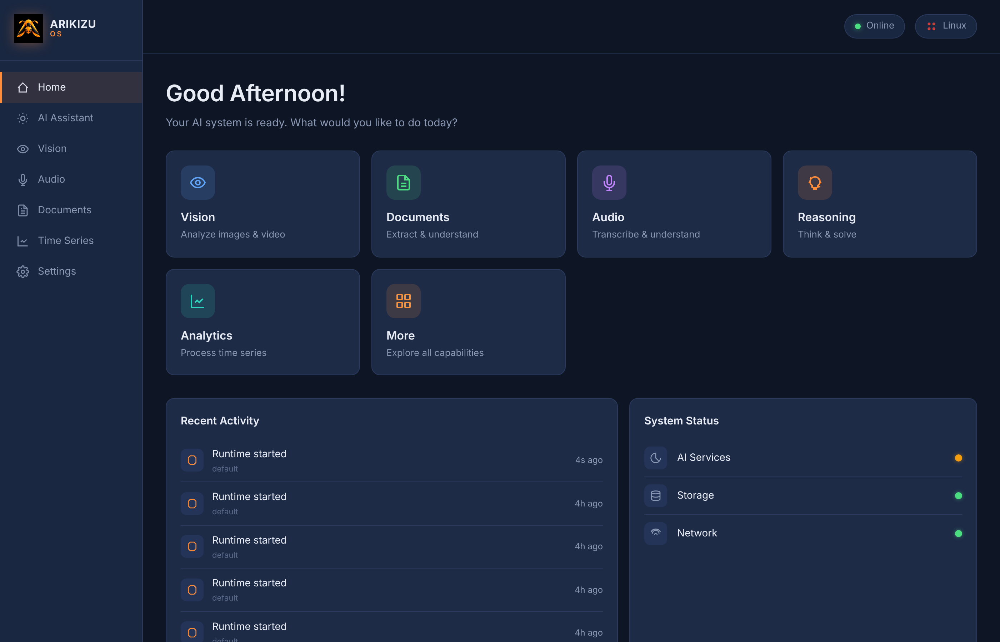
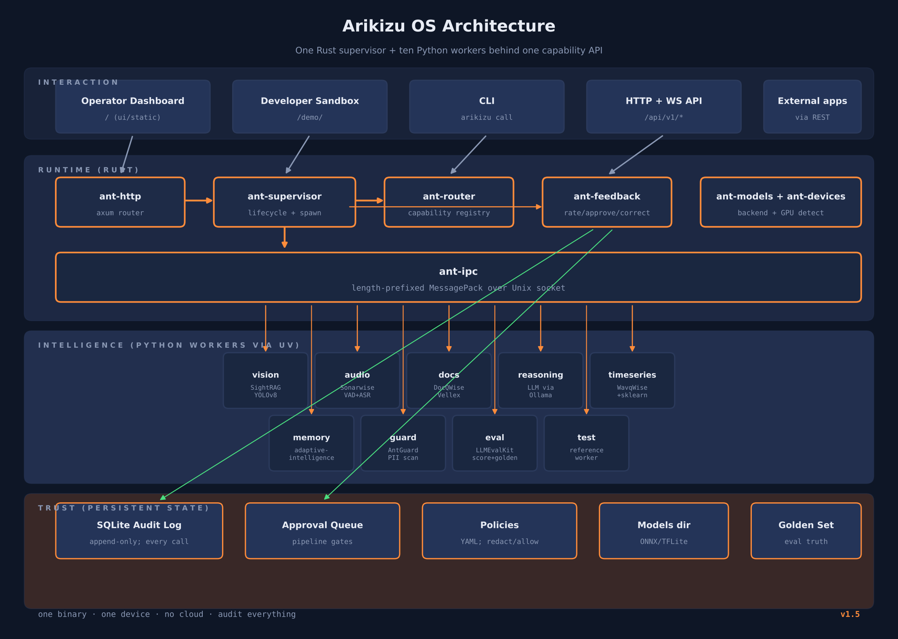
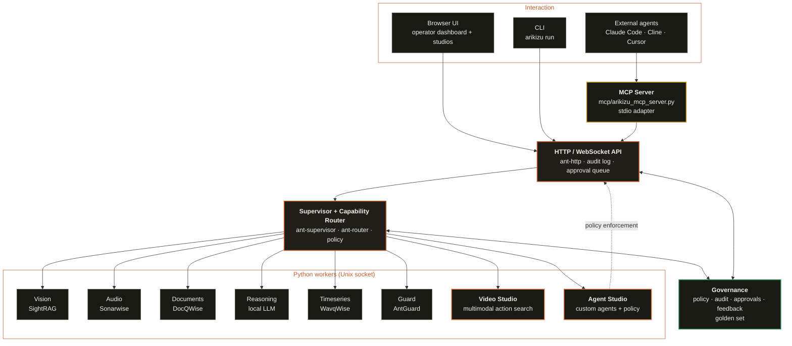

<p align="center">
 
</p>

<h1 align="center">Arikizu OS</h1>

<p align="center">
 <em>Edge-first, offline-first, responsible-AI OS for a single device.</em>
</p>

<p align="center">
 <a href="QUICKSTART.md">Quickstart</a> ·
 <a href="docs/DEMO.md">Demo walkthrough</a> ·
 <a href="docs/CUSTOMIZE.md">Customize</a> ·
 <a href="docs/AGENTS.md">Agents</a> ·
 <a href="docs/MCP.md">MCP</a> ·
 <a href="docs/GOVERNANCE.md">Governance</a> ·
 <a href="docs/ARCHITECTURE.md">Architecture</a> ·
 <a href="docs/MODELS.md">Models</a> ·
 <a href="docs/HOW_IT_RUNS.md">How it runs</a> ·
 <a href="SECURITY.md">Security</a>
</p>

---

Edge-first, offline-first, responsible-AI operating system for a single
device.

Think a local LLM runtime, but for the full AI stack: vision, audio, documents,
time series, reasoning, memory, policy enforcement, and human-in-the-loop
feedback, all behind one capability API. One Rust supervisor spawns a set
of Python workers that wrap VK's Ant Intelligence libraries (SightRAG,
Sonarwise, DocQWise, WavqWise, adaptive-intelligence, LLMEvalKit, AntGuard).
Everything is served from one binary on one device (Jetson Orin Nano,
Raspberry Pi, or small x86_64 server) with a browser dashboard, an
append-only audit log, and no cloud account required.

Why "OS": the Rust runtime does what init + syscall-dispatch + policy + syslog
do for Linux, scoped to the AI layer. See [`docs/WHY_OS.md`](docs/WHY_OS.md)
for the full argument, and [`docs/HOW_IT_RUNS.md`](docs/HOW_IT_RUNS.md) for
the stack diagram (Arikizu is a systemd service on top of Raspberry Pi OS;
Linux is not replaced).

Target: a factory supervisor, nurse, ship engineer, or heritage conservator
should install Arikizu with one command, connect cameras and mics, and start
a pipeline from a web UI without touching Python.

## Where it runs

Arikizu is designed for the full edge device family. Reference device is
the Jetson Orin Nano 8 GB. Also runs on:

| Device | Notes |
| ------------------------------------------- | ------------------------------------- |
| Nvidia Jetson Orin Nano / AGX Orin | Best performance, GPU backend |
| Mac (Apple Silicon or Intel) | Dev-friendly, CoreML backend |
| Linux x86_64 (laptop, desktop, small server) | Great for prototyping |
| Raspberry Pi 4 (4 GB) or Pi 5 | Entry-level, lowest-cost demo |
| Windows via WSL2 | Dev only |

Current demo targets the Pi 4 because that is the hardware I have in
hand. The same binary and code run on all of the above.

---

## Prerequisites (install these first)

Four things. The `scripts/check_prereqs.sh` script tells you which are
missing. Install the missing ones:

**Rust (the supervisor is written in Rust):**

```
curl --proto '=https' --tlsv1.2 -sSf https://sh.rustup.rs | sh
source "$HOME/.cargo/env"
rustc --version # should print rustc 1.80+
```

**uv (manages Python workers, faster than pip):**

```
curl -LsSf https://astral.sh/uv/install.sh | sh
exec $SHELL -l
uv --version # should print uv 0.4+
```

**System packages (platform specific):**

- Mac: `xcode-select --install && brew install pkg-config openssl portaudio`
- Linux / WSL / Pi / Jetson: `sudo apt install -y build-essential git curl pkg-config libssl-dev python3-pip`

**4 GB swap (ONLY if your device has 4 GB RAM or less, like a Pi 4):**

```
sudo fallocate -l 4G /swapfile && sudo chmod 600 /swapfile
sudo mkswap /swapfile && sudo swapon /swapfile
echo "/swapfile none swap sw 0 0" | sudo tee -a /etc/fstab
```

Full device-by-device walkthrough with troubleshooting:
[`docs/SETUP.md`](docs/SETUP.md).

---

## Try it in 5 minutes (laptop)

Once the prereqs above are in place:

```
git clone https://github.com/VK-Ant/arikizu
cd arikizu
scripts/check_prereqs.sh
scripts/bootstrap.sh # installs Python workers via uv sync
make build # cargo build --release
make run # starts supervisor + HTTP server on :7000
```

Open two things in your browser:

| URL | What |
| ------------------------------- | ----------------------------------------------------------------- |
| http://127.0.0.1:7000/ | **Operator dashboard** (home). Greeting, 6 capability cards, recent activity, system status. |
| http://127.0.0.1:7000/demo/ | **Developer sandbox**. One page per capability for raw testing. |

<p align="center">
 
</p>

In a second terminal, confirm every worker is answering:

```
make smoke
```

Expected: `0 failing`. WAIT means a library is scaffolded but the real
library is not yet wired; same code path, no fix needed to run demos.

**If a demo is not working**, run the one-shot diagnostic:

```
make doctor
```

It prints PASS/FAIL per component (python version, onnxruntime, llama-cpp,
yolov8n.onnx, silero_vad.onnx, SmolLM2 GGUF, supervisor http) and the
exact fix line for each failure. Most "nothing works" problems are one
missing model file; `scripts/download-default-models.sh` fixes that.

---

## Two things that catch everyone first time

### "Video Studio shows unknown / 0 objects / 0 people"

The video stack is MISSING on the Diagnostics panel. MediaPipe isn't
installed yet. One command fixes it:

```bash
cd workers
uv add mediapipe --package video-worker
cd ..
scripts/download-video-models.sh
pkill -f arikizu && make run
```

The webcam and video analysis should work immediately after restart.

### "Agent Studio gives generic / wrong answers"

The default reasoning model is SmolLM2-360M (230 MB). That is a 360-
million-parameter model: enough for canned Q&A, too small to follow a
system prompt or emit structured tool calls. The agent's answers will
look generic or wrong.

For Agent Studio to actually work, download a properly-sized LLM:

```bash
scripts/download-reasoning-llm.sh --size 1.5b     # Qwen2.5-1.5B ~1.0 GB
pkill -f arikizu && make run
```

The reasoning worker auto-detects the bigger model on restart. The
Agent Studio header shows which LLM is in use; if it says
"too small for agent chat", that is the signal.

Sizes available: `--size 0.5b` (400 MB), `1.5b` (1 GB, recommended),
`3b` (2 GB), `7b` (4.4 GB). Pick what fits your device.

---

## Enable the full stack (Video Studio + Agent Studio + MCP)

The 5-minute quickstart runs the base workers (vision, audio, docs,
reasoning, timeseries, memory, guard, eval, test). The newer workers
and the MCP server are opt-in because they have heavier dependencies.

### Video Studio

Needs MediaPipe LiteRT and optionally llama-cpp-python for the VLM.

```bash
# Perception stack: object detection, pose, segment, scene parse (~22 MB)
cd workers && uv add mediapipe --package video-worker
cd ..
scripts/download-video-models.sh

# Optional: Qwen2.5-VL 3B for open-vocabulary action search (~2.7 GB)
cd workers && uv add llama-cpp-python --package video-worker
cd ..
scripts/download-video-models.sh --with-vlm

# Restart
pkill -f arikizu; make run
```

Open `http://127.0.0.1:7000/demo/video_studio.html`. The device banner
at the top tells you which models were loaded and what FPS to expect
on your hardware.

### Agent Studio

No extra deps; the worker is in the base install. Just make sure the
reasoning worker has a working backend (local GGUF, HTTP endpoint, or
built-in KB).

Open `http://127.0.0.1:7000/demo/agent_studio.html`. Click **Import
examples** to load five ready-made agents, then chat with one.

Or import from the command line:

```bash
curl -X POST http://127.0.0.1:7000/api/v1/call/agent/import \
  -H 'content-type: application/json' \
  -d '{"payload": {"file_path": "examples/agents/safety-inspector.json"}}'
```

### MCP server (external agents call Arikizu)

```bash
pip install mcp httpx
export ARIKIZU_HTTP=http://127.0.0.1:7000
python3 mcp/arikizu_mcp_server.py          # test it runs
```

Then wire it up to Claude Code / Cline / Cursor using one of the config
snippets in [`examples/mcp-configs/`](examples/mcp-configs/). Replace
the `/ABSOLUTE/PATH/TO/arikizu` placeholder with your checkout path.

### All at once (one terminal, copy-paste)

```bash
# From the arikizu/ root, after `make build && make run` in another terminal:
cd workers && uv add mediapipe llama-cpp-python --package video-worker
cd ..
scripts/download-video-models.sh --with-vlm
pip install mcp httpx
pkill -f arikizu && make run
# Open http://127.0.0.1:7000/demo/ in your browser
```

Then:

```bash
# Import the 5 example agents
for a in safety-inspector elder-care-companion document-reviewer sensor-triage retail-floor; do
  curl -s -X POST http://127.0.0.1:7000/api/v1/call/agent/import \
    -H 'content-type: application/json' \
    -d "{\"payload\":{\"file_path\":\"examples/agents/${a}.json\"}}" | head -c 100
  echo
done
```

### Verify every piece is live

```bash
make doctor                                    # system-level checks
curl -s http://127.0.0.1:7000/api/v1/status    # workers running
# Open each demo page in a browser; the Diagnostics panel on /demo/
# shows a green READY tag per subsystem.
```

Call a capability by hand:

```
curl -X POST http://127.0.0.1:7000/api/v1/call/test/echo \
 -H 'content-type: application/json' \
 -d '{"payload":{"message":"hello"}}'
# {"echo":"hello"}
```

That is the full round trip: HTTP in, Rust router dispatch, Python worker
answer, response back. Everything else is more interesting data flowing
through the same path.

Full demo walkthrough with screenshots and expected outputs:
[`docs/DEMO.md`](docs/DEMO.md).

---

## Video Studio: multimodal action search

Upload a clip or open your webcam. Give the system a text prompt, a reference
image, or nothing at all. Get back a timestamped list of actions, who and what
is in the scene, how fast they are moving, and the room they are in. Everything
runs on your device.

Three inputs, same pipeline:

1. **No prompt.** Default rule-based recognition over 12 actions (walking,
   running, sitting, standing, waving, kicking, jumping, hands-up, arms-crossed,
   bending, falling, pointing).
2. **Text prompt.** "A person waving at the camera." The VLM scores every
   sampled frame against the prompt.
3. **Reference image.** Drop a screenshot of the action you want to find. The
   VLM describes it, then searches the target video.

Backbone: MediaPipe LiteRT (object detection, pose landmarks, segmentation,
face privacy), SegFormer-B0 int8 for scene parsing, dense optical flow for
motion, multi-object tracking with trails. All on CPU with XNNPACK, GPU
delegate on Jetson. Qwen2.5-VL 3B Q4_K_M on top for open-vocabulary action
search when the VLM is available.

**Device-aware model selection.** On page load the demo calls
`video.device_report` and shows which model preset is recommended for your
hardware. On a Pi 4 you see the rule-based path only. On a Jetson Orin Nano
or newer, the VLM is enabled. The table of fit per device is shipped as
code in [`workers/video_worker/video_worker/devices.py`](workers/video_worker/video_worker/devices.py).

Open [`http://127.0.0.1:7000/demo/video_studio.html`](http://127.0.0.1:7000/demo/video_studio.html).

---

## Custom agents and MCP

Two ways to build on top of Arikizu's capabilities, both governed by
the same policy and audit layer.

**Agent Studio.** Create your own chatbots inside Arikizu. Give each
agent a name, a system prompt, and a policy (which capabilities it may
call directly, which require human approval, which are refused). The
agent runs in `agent_worker`, talks via the local reasoning worker,
emits tool calls, and the dispatcher enforces the policy before any
call reaches another worker. Full UI at
[`/demo/agent_studio.html`](http://127.0.0.1:7000/demo/agent_studio.html).
Guide: [`docs/AGENTS.md`](docs/AGENTS.md).

**MCP server.** For agents that live OUTSIDE Arikizu (Claude Code,
Cline, Cursor, your own framework), Arikizu ships an MCP server at
[`mcp/arikizu_mcp_server.py`](mcp/arikizu_mcp_server.py). It exposes a
safe subset of capabilities as MCP tools. External agents call them
like any other tool; the calls still land on the HTTP router and go
through the global policy and audit. Guide:
[`docs/MCP.md`](docs/MCP.md).

**Responsible AI by architecture.** Policy + audit + approval are not a
layer bolted on. The system is designed so that governance is a thin,
local, auditable ring around a runtime whose data never leaves the
device. Four claims and the SQL queries that verify them:
[`docs/GOVERNANCE.md`](docs/GOVERNANCE.md).

---

## Download, customize, use

**Everything in this repo is Apache 2.0.** Clone it, fork it, strip
parts you don't need, add parts you do, ship your own product on top.
No attribution required for the code; the bundled model files keep
their own upstream licenses (see `models/NOTICE.md`).

Ready-to-use starting points live in [`examples/`](examples/):

- [`examples/agents/`](examples/agents/) — five ready-to-import JSON
  agents (Safety Inspector, Elder Care Companion, Document Reviewer,
  Sensor Triage, Retail Floor Watcher). One `curl` or one click in the
  Agent Studio imports all five.
- [`examples/actions/`](examples/actions/) — custom action rules you
  can drop into `video_worker/actions.py` (squatting, reaching_up,
  looking_down, hugging, thumbs_up). Each is one function, no training.
- [`examples/mcp-configs/`](examples/mcp-configs/) — `.mcp.json`
  snippets for Claude Code, Cline, and Cursor.
- [`examples/demo-pages/blank.html`](examples/demo-pages/blank.html) —
  blank HTML template with the shared Arikizu header and palette; copy
  and fill in to start your own demo page in one step.

See [`examples/README.md`](examples/README.md) for the full list and
the one-liner commands to import each one into a running Arikizu.

---

## Make it yours

Everything you'd want to change is one file edit. The guide walks
through each with concrete code snippets:

- Swap a model (your ONNX / GGUF, or a bigger YOLO)
- Add a new capability (`your.predict` → `/api/v1/call/your/predict`)
- Add a new worker (wrap your own library as its own process)
- Rebrand the UI (logo, name, colors — one CSS token controls the whole palette)
- Add your own demo page (copy an existing page, call your capability)
- Load your own data (file upload, server-side path, webcam / mic, LAN sensor stream)
- Deploy on Pi / Jetson / Mac / Linux / WSL

See [`docs/CUSTOMIZE.md`](docs/CUSTOMIZE.md).

---

## Default models

**yolov8n.onnx (12 MB) and silero_vad.onnx (2.3 MB) ship pre-installed
in `models/`.** The vision and audio demos work the moment you run
`make run` — no download step. See `models/NOTICE.md` for upstream
licenses (YOLO is AGPL-3.0, Silero VAD is MIT).

For the local LLM (reasoning), run the download script:

```
scripts/download-default-models.sh --tier minimum
# adds smollm2-360m-instruct-q4_k_m.gguf (258 MB)
```

Reasoning falls back to a built-in Q&A knowledge base when the GGUF
is absent, so the demo still runs without this.

Higher tiers add ASR and embeddings:

| Tier | Adds | Size |
| ---------- | ----------------------------------------------------- | ------- |
| `minimum` | SmolLM2 360M GGUF | 258 MB |
| `standard` | Whisper tiny.en encoder, MiniLM-L6-v2 embedder, Qwen 2.5 0.5B | ~500 MB |
| `full` | Table Transformer, YOLOv8s, Whisper small.en encoder | ~900 MB |

Backends are auto-selected per device:

- Jetson: `onnxruntime-gpu` from the Jetson AI Lab index, TensorRT when available
- Pi 4/5: `onnxruntime` CPU
- Mac (Apple Silicon): `onnxruntime` with CoreML execution provider
- Linux x86_64 with NVIDIA: `onnxruntime-gpu` + CUDA
- Linux x86_64 without NVIDIA: `onnxruntime` CPU

`scripts/install-runtime.sh` detects your device and installs the matching
runtime. See [`docs/MODELS.md`](docs/MODELS.md) for the per-worker catalog
and model-swap steps.

---

## Install (three tiers)

Each tier is a different claim; see [`docs/DISTRIBUTION.md`](docs/DISTRIBUTION.md).

### Tier 3: Flash to a Pi (how it becomes an OS)

```
# Download arikizu-pi-vX.Y.Z.img.xz from GitHub Releases
# Flash with Raspberry Pi Imager, boot, open http://arikizu.local
```

Planned for Weekend 15; CI scaffolding in `.github/workflows/image.yml`
and `packaging/pi-gen/`.

### Tier 2: System package (existing Pi/server/Jetson)

```
echo "deb https://apt.arikizu.sh stable main" | sudo tee /etc/apt/sources.list.d/arikizu.list
curl -fsSL https://apt.arikizu.sh/arikizu.gpg | sudo gpg --dearmor \
 -o /etc/apt/trusted.gpg.d/arikizu.gpg
sudo apt update && sudo apt install arikizu
```

Pre-built aarch64 binary + Python wheels + systemd unit + default config.
Planned for Weekend 15; packaging scaffolded under `packaging/debian/`.

### Tier 1: Developer binary (laptop)

```
curl -fsSL https://arikizu.sh/install.sh | sh
```

Lands in `~/.arikizu/bin/arikizu`. No root, no service. SDK/CLI positioning,
not the OS install.

### Build from source (recommended today)

```
git clone https://github.com/VK-Ant/arikizu
cd arikizu
scripts/check_prereqs.sh
scripts/bootstrap.sh
make build && make run
```

> **Pi memory honesty.** Building Rust from source on a Pi needs 2-3 GB
> RAM for linking. Pi Zero 2 W and 1 GB Pi 4 cannot do this without heavy
> swap thrashing; use Tier 2 or Tier 3 only.

Full Pi setup, swap configuration, hardware probe, and the laptop-to-Pi
promotion workflow: [`QUICKSTART.md`](QUICKSTART.md).

---

## Demo views

Every view is a plain HTML file served by the Rust server. No build step,
no npm, no bundler. Open `http://127.0.0.1:7000/demo/` for the hub.

| View | What it shows |
| --------------------------------------- | ----------------------------------------------------------------------- |
| `/` | Operator dashboard: greeting, 6 capability cards, recent activity |
| `/demo/` | Developer hub: one card per capability, direct links |
| `/demo/vision_live.html` | Live annotated frames with FPS counter and detection list |
| `/demo/vision_search.html` | Audit-log search for past detections |
| `/demo/audio_view.html` | Waveform draw + VAD segments + transcript |
| `/demo/docs_view.html` | Schema editor + extracted fields + docs.search |
| `/demo/timeseries_view.html` | Line chart + forecast + anomaly markers |
| `/demo/reasoning_chat.html` | Chat with the local LLM worker (answer / summarize / complete) |
| `/demo/memory_view.html` | Session memory: update / recall / reward |
| `/demo/guard_view.html` | PII scan + redacted preview (side by side) |
| `/demo/eval_view.html` | Predicted vs expected + score cards (exact, Jaccard, Golden set) |

Walkthrough of each one with expected output: [`docs/DEMO.md`](docs/DEMO.md).

---

## Promote to Raspberry Pi

Only after `make test` and `make smoke` are green on your laptop:

```
# on the Pi (Pi 4 or 5, Pi OS 64-bit)
sudo apt install -y build-essential git curl pkg-config libssl-dev \
 python3-picamera2 python3-opencv alsa-utils libportaudio2
curl --proto '=https' --tlsv1.2 -sSf https://sh.rustup.rs | sh
curl -LsSf https://astral.sh/uv/install.sh | sh
git clone https://github.com/VK-Ant/arikizu
cd arikizu && scripts/bootstrap.sh
make build && make run # terminal 1
make smoke # terminal 2
```

Dashboard from your laptop: `http://arikizu-dev.local:7000/`
(or the Pi's IP from `hostname -I`).

Pi vision tutorial (Pi Camera + the vision model + approval gate, 1 hour):
[`docs/PI_VISION_TUTORIAL.md`](docs/PI_VISION_TUTORIAL.md).

---

## Architecture

<p align="center">
 
</p>

Full architecture reference: [`docs/ARCHITECTURE.md`](docs/ARCHITECTURE.md) (also [PDF](docs/ARCHITECTURE.pdf)).

## Architecture at a glance



Four zones:

- **Interaction** — HTTP, dashboard, CLI, voice input
- **Runtime** — supervisor, router, worker lifecycle, policy enforcement
- **Intelligence** — the Ant Intelligence libraries wrapped as workers
- **Trust** — feedback manager, audit log, approval queue, golden set

Feedback manager is a peer of the supervisor, not a subsystem. Every
pipeline can insert an approval gate. Every call can be rated. Every
correction feeds the next training cycle.

---

## Docs

**Start here**

- [`docs/SETUP.md`](docs/SETUP.md): complete beginner guide for every edge device: Pi, Jetson, Mac, Linux, WSL. Each step tagged by device. Zero Linux knowledge needed.
- [`QUICKSTART.md`](QUICKSTART.md): the shorter path for people comfortable with the terminal
- [`docs/DEMO.md`](docs/DEMO.md): click-by-click walkthrough of every demo view
- [`docs/PI_VISION_TUTORIAL.md`](docs/PI_VISION_TUTORIAL.md): 1-hour hands-on: Pi + Camera + the vision model + approval gate

**Understand it**

- [`docs/ARCHITECTURE.md`](docs/ARCHITECTURE.md): full architecture reference (14 sections, with diagram and PDF export)
- [`docs/WHY_AND_WHO.md`](docs/WHY_AND_WHO.md): why this exists, who it's for, where it helps, where it doesn't
- [`docs/WHY_OS.md`](docs/WHY_OS.md): the "is this really an OS?" argument
- [`docs/HOW_IT_RUNS.md`](docs/HOW_IT_RUNS.md): stack diagram + boot sequence
- [`docs/DISTRIBUTION.md`](docs/DISTRIBUTION.md): three install tiers (dev binary, deb, flashable image)
- [`docs/MODELS.md`](docs/MODELS.md): LLM strategy, runtime optimization, per-worker catalog, defaults
- [`docs/MODULES.md`](docs/MODULES.md): per-module index with links to each crate and worker README
- [`docs/SPEC.md`](docs/SPEC.md): non-fit list, five-point qualification, eleven target verticals

**Project hygiene**

- [`CONTRIBUTING.md`](CONTRIBUTING.md): branch, commit, PR convention
- [`SECURITY.md`](SECURITY.md): threat model, dependency validation, reporting

---

## Project layout

```
arikizu/
 Cargo.toml workspace manifest (9 crates)
 arikizu.yaml.example reference pipeline config
 capabilities.toml capability registry (29 capabilities today)
 crates/ Rust workspace
 ant-common/ core types shared by every crate
 ant-ipc/ length-prefixed MessagePack over Unix sockets
 ant-router/ capability registry loader and lookup
 ant-supervisor/ worker lifecycle, spawn, call, shutdown
 ant-models/ model manifest, SHA-256 verification, backend selection
 ant-devices/ CPU / GPU / Jetson detection
 ant-feedback/ rate, correct, approve, reject, annotate
 ant-http/ axum REST + WebSocket + static file surface
 ant-cli/ the `arikizu` binary
 workers/ Python workspace (uv)
 arikizu-worker-sdk/ Python IPC shim; every worker imports this
 test_worker/ reference worker, used by CI
 vision_worker/ wraps SightRAG + ONNX inference
 audio_worker/ wraps Sonarwise + VAD + ASR
 docs_worker/ wraps DocQWise
 reasoning_worker/ local LLM via a lightweight runtime / LAN gateway
 timeseries_worker/ wraps WavqWise + classical statistical models
 memory_worker/ wraps adaptive-intelligence
 guard_worker/ wraps AntGuard (PII scan + redact)
 eval_worker/ wraps LLMEvalKit (score + golden set)
 ui/
 static/index.html operator dashboard served at /
 demo/web/ developer sandbox served at /demo/
 policies/ reference security and governance policies
 golden/ golden-set evaluation data
 scripts/ bootstrap, prereqs, runtime install, model download
 packaging/ debian/, pi-gen/, systemd unit
 docs/ design notes and walkthroughs
```

---

## Roadmap

Current release wires up every worker, dashboard, and audit path end
to end. Future weekends deepen specific capabilities with the
Ant Intelligence libraries.

| When | What |
| ------------ | ---------------------------------------------------------- |
| Weekend 5 | Full vision pipeline (SightRAG: segmentation, tracking) |
| Weekend 6 | Full audio pipeline (Sonarwise: speaker ID, embeddings) |
| Weekend 7 | Full document pipeline (DocQWise layout parsing) |
| Weekend 8 | Long-range forecasting (WavqWise) |
| Weekend 9 | Persistent memory (adaptive-intelligence) |
| Weekend 10 | ML-based PII detectors (AntGuard) |
| Weekend 12 | LLM-as-judge scoring (LLMEvalKit) |
| Weekend 15 | Signed model manifest + apt feed + flashable Pi image |
| Weekend 20 | Full public release |

Non-fit list, five-point qualification, and target verticals:
[`docs/SPEC.md`](docs/SPEC.md).

---

## License

Apache License 2.0. See [LICENSE](LICENSE).

Copyright 2026 Venkatkumar Rajan (VK-Ant). The Arikizu mark and logo
(`docs/assets/logo.png`) remain the property of the project.

## Attribution

Built by VK (Venkatkumar Rajan). Part of the Ant Intelligence Ecosystem.
