# Arikizu Architecture

This document covers the full architecture: system layers, modules in the repo, the technical spec, and how everything runs on real hardware.

- [Part 1 — System architecture](#part-1--system-architecture)
- [Part 2 — Module index](#part-2--module-index)
- [Part 3 — How it runs on hardware](#part-3--how-it-runs-on-hardware)
- [Part 4 — Technical spec v2 pointer](#part-4--technical-spec-v2-pointer)

---

## Part 1 — System architecture


<p align="center">
 
</p>

One Rust binary that supervises eleven Python workers (including the
Video Studio worker for multimodal action search). One HTTP surface for
every capability. One SQLite file for every event. One device, one
install, no cloud.

What follows: how it fits together, where state lives, where the
moving parts are. For why it is called an OS, see
[`WHY.md`](WHY.md). For how it sits on top of Raspberry Pi OS,
see [`ARCHITECTURE.md`](ARCHITECTURE.md).

---

## 1. Four zones

The system splits cleanly into four zones. Each zone has one job and a
single, deliberate boundary with the next.

| Zone | What it does | Tech |
| ----------------- | ----------------------------------------------------- | ----------------------------- |
| **Interaction** | How humans and apps talk to Arikizu | HTTP, WebSocket, CLI, browser |
| **Runtime** | Supervision, routing, policy, device detection | Rust (9 crates) |
| **Intelligence** | The actual AI work | Python (11 workers, uv) |
| **Trust** | Everything we promise to remember or enforce | SQLite, YAML, filesystem |

Picture at the top of this file shows the same split visually.

---

## 2. Interaction zone (what the user sees)

Four entry points. All of them land on the same `/api/v1/*` surface.

### 2.1 Operator dashboard (`/`)

Served from `ui/static/index.html` by `ant-http`'s fallback service.
Zero build step, no npm. Pulls live data from three endpoints:

| Endpoint | What it shows on the dashboard |
| --------------------------------------- | ------------------------------------------ |
| `GET /api/v1/status` | Device chip, worker count, uptime |
| `GET /api/v1/audit?limit=5` | Recent activity feed |
| `GET /api/v1/capabilities` | How many capabilities exist |

Mobile responsive. Sidebar collapses under 700 px.

### 2.2 Developer sandbox (`/demo/`)

Served from `demo/web/`. One HTML file per capability. Each one is a
few hundred lines of plain JS that `fetch`'s the matching `/api/v1/call/<cap>`
endpoint. This is the surface used for raw testing and demos.

### 2.3 CLI (`arikizu call ...`)

The `ant-cli` crate speaks the same HTTP API. Example:

```
arikizu call test.echo '{"message":"hello"}'
```

That is `POST /api/v1/call/test/echo` with the payload wrapped in a
`{"payload":...}` envelope.

### 2.4 External apps

Anything that can `POST` JSON can drive Arikizu. The capability API is
stable; a shell script, a Rust service, or a Jupyter notebook all look
the same from the server side.

---

## 3. Runtime zone (the Rust core)

Nine crates in one Cargo workspace. Each one is small and does one
thing.

```
crates/
 ant-common/ core types, errors, result type
 ant-ipc/ length-prefixed MessagePack over Unix socket
 ant-router/ capabilities.toml loader, lookup by name
 ant-supervisor/ worker lifecycle: spawn, call, shutdown, restart
 ant-models/ model manifest, SHA-256 verification, backend pick
 ant-devices/ CPU / GPU / Jetson detection
 ant-feedback/ rate, correct, approve, reject, annotate
 ant-http/ axum REST + WebSocket + static file serving
 ant-cli/ the `arikizu` binary
```

### 3.1 ant-common (foundation)

Types every other crate uses. Errors (`ArikizuError`), result (`Result<T>`),
the pipeline config shape (`ArikizuConfig`), feedback labels, event enums.
Nothing async here. Nothing I/O. Pure data.

### 3.2 ant-ipc (the pipe)

The Rust side of the IPC. Length-prefixed MessagePack frames over a
Unix domain socket. The Python SDK (`arikizu-worker-sdk`) speaks the
same wire format on the other end. Chosen over gRPC because:

- No code generation step.
- Smaller binary.
- MessagePack is one Python import, one Rust crate.
- Length-prefix is easy to debug.

### 3.3 ant-router (capability registry)

Loads `capabilities.toml` at boot. Every capability declares:

```toml
[vision_detect]
name = "vision.detect"
worker = "vision"
timeout_ms = 5000
priority = 10
```

The router is a `HashMap<String, CapabilitySpec>` with a few helpers
(`by_worker`, `names`, `get`). 29 capabilities registered today.

### 3.4 ant-supervisor (the heart)

Owns every worker handle. For each worker in `arikizu.yaml`:

1. `spawn()`: forks a Python subprocess (`uv run --package <worker> python -m <worker>`), binds a Unix socket, waits for the worker to connect (60 s timeout for first-run dep downloads).
2. `call(cap, payload, timeout)`: writes a MessagePack frame to the socket, awaits the response, returns JSON.
3. `shutdown()`: sends a close frame, waits for the subprocess, SIGKILLs if it does not go.
4. Broadcasts worker state transitions on a `tokio::sync::broadcast` channel for the WebSocket event bus.

Also runs the pipeline executor (`run_pipeline`): walks a list of
stages, honors `feedback.approve` gates (blocks the stage until the
approval queue sees an approve or reject), writes a run record to the
audit log.

### 3.5 ant-models (model selection)

Reads `models.toml` manifest, verifies SHA-256 of each file on disk,
picks a backend per device. The decision table lives in
`backend_selection.rs`:

| Platform | Backend chain |
| ---------------------- | --------------------------------------- |
| Jetson (any Orin) | TensorRT -> onnxruntime-gpu -> CPU |
| Linux x86_64 + NVIDIA | onnxruntime-gpu (CUDA) -> CPU |
| Mac (Apple Silicon) | onnxruntime (CoreML EP) -> CPU |
| Pi 4 / 5 | onnxruntime (CPU) |
| Everything else | onnxruntime (CPU) |

Each worker's `.backends` capability lets the dashboard see what was
picked for that worker.

### 3.6 ant-devices (hardware probe)

Reads `/proc/cpuinfo`, `/proc/meminfo`, `nvidia-smi`, and the Jetson
device tree. Returns `DeviceInventory { platform, is_jetson, cpus,
gpus, total_memory_mb }`. The dashboard chip ("Raspberry Pi", "Jetson",
"Mac") is driven from this.

### 3.7 ant-feedback (human in the loop)

Four tables in SQLite:

| Table | Rows written when |
| --------------- | ---------------------------------------------------- |
| `ratings` | `/feedback/rate` is called |
| `corrections` | `/feedback/correct` is called |
| `approvals` | A pipeline stage hits a `feedback.approve` gate |
| `annotations` | `/feedback/annotate` is called |

The pending-approvals queue is an in-memory `HashMap<Uuid, PendingApproval>`
backed by `approvals` on restart. Dashboard reads it via
`GET /api/v1/feedback/pending`.

### 3.8 ant-http (the surface)

An `axum` router with 14 routes, grouped:

```
GET / operator dashboard (fallback_service)
GET /demo/* developer sandbox (nest_service)
GET /health liveness probe
GET /api/v1/status runtime summary
GET /api/v1/devices hardware inventory
GET /api/v1/capabilities capability list
GET /api/v1/workers worker list
POST /api/v1/call/:domain/:op the only API that matters
GET /api/v1/audit tail of audit log
GET /api/v1/events WebSocket event feed
POST /api/v1/feedback/* 5 feedback endpoints
GET /api/v1/pipeline/config pipeline YAML
POST /api/v1/pipeline/run kick off a pipeline run
GET /api/v1/runtime aggregated per-worker runtime info
POST /api/v1/stop graceful shutdown
```

All JSON. All synchronous except `/events`. All documented in
`docs/ARCHITECTURE.md` with request / response shapes.

### 3.9 ant-cli (the binary)

`clap`-driven CLI. Subcommands:

```
arikizu run launch supervisor + HTTP server (what systemd runs)
arikizu call <cap> POST /api/v1/call via reqwest
arikizu status GET /api/v1/status, pretty-print
arikizu stop POST /api/v1/stop
arikizu check runtime health probe
arikizu models list list models known from models.toml
```

Everything the CLI does is a thin HTTP client over `127.0.0.1:7000`.
No shared state with the running process.

---

## 4. IPC layer (the pipe between Rust and Python)

The one place where Rust and Python meet.

### 4.1 Wire format

```
[4 bytes big-endian length N][N bytes MessagePack body]
```

Body is a MessagePack map. Request:

```
{
 "id": <uuid v4>,
 "capability": "vision.detect",
 "payload": { ... any JSON ... },
 "deadline_ms": 5000
}
```

Response:

```
{
 "id": <same uuid>,
 "ok": true|false,
 "result": { ... } | null,
 "error": "..." | null
}
```

### 4.2 Transport

Unix domain socket at `/tmp/arikizu-<worker>-<uuid>.sock` (one per
worker, per supervisor run). Why not TCP:

- No port management.
- Filesystem-permission security (owner-only).
- Faster (no TCP stack overhead) on the Pi.
- Harder to accidentally expose to the network.

### 4.3 Python side (arikizu-worker-sdk)

Every worker imports this one SDK. Boilerplate it hides:

- Socket setup, length-prefix framing, MessagePack encode / decode
- Capability registration (`@capability("vision.detect")`)
- Timeout handling, error wrapping
- Backend auto-selection (ONNX / TFLite / OpenVINO / TensorRT / CoreML)
- Graceful shutdown on SIGTERM

Writing a new worker is: install the SDK, decorate functions, run.
~30 lines for a working worker, including imports.

---

## 5. Intelligence zone (Python workers)

Eleven workers, each in its own uv package under `workers/`.

| Worker | Wraps | Capabilities |
| ------------ | ------------------------------- | ----------------------------------------------------------------- |
| `test` | nothing (reference impl) | `test.echo`, `test.sleep`, `test.fail` |
| `vision` | SightRAG + a compact vision model | `vision.detect`, `vision.segment`, `vision.track`, `vision.backends` |
| `audio` | Sonarwise + a VAD model + the ASR model | `audio.vad`, `audio.transcribe`, `audio.backends` |
| `docs` | DocQWise | `docs.extract`, `docs.search` |
| `reasoning` | a local LLM endpoint | `reasoning.answer`, `reasoning.summarize`, `reasoning.complete` |
| `timeseries` | WavqWise + classical ML libraries + scipy | `timeseries.forecast`, `timeseries.anomaly` |
| `memory` | adaptive-intelligence | `memory.update`, `memory.recall`, `memory.reward` |
| `guard` | AntGuard (regex v0.1) | `guard.scan`, `guard.redact` |
| `eval` | LLMEvalKit | `eval.score`, `eval.golden_run` |
| `video` | MediaPipe LiteRT + SegFormer int8 + Qwen2.5-VL 3B (optional) | `video.live_detect`, `video.analyze_frame`, `video.live_describe`, `video.recognize_pose`, `video.actions_known`, `video.search_image`, `video.device_report`, `video.backends`, `video.history`, `video.record_analysis` |
| `feedback` | n/a (handled by ant-feedback) | (Rust-side only) |

The `video` worker is the newest and the most composable. It covers the full
on-device video-intelligence pipeline: object detection, pose landmarks, scene
parsing, face privacy blur, 12 rule-based action recognizers, and
multimodal action search via a local VLM when the hardware supports it.
Device-aware model selection (see `workers/video_worker/video_worker/devices.py`)
means the same code path runs on a Pi 4 (rule-based only) and a Jetson
Orin Nano (full VLM pipeline) without config changes.

Each worker:

- Runs under its own uv venv, so dependency conflicts can't happen.
- Is CPU-bound by default; GPU use is backend-driven.
- Can be swapped out of `arikizu.yaml` with one line of config.
- Loads models from `models/` only on first call (lazy init).

Full catalog: [`SETUP.md`](SETUP.md).

---

## 6. Trust zone (what survives a restart)

Persistent state has a dedicated zone because it is what Arikizu
promises to its users. Four kinds.

### 6.1 SQLite audit log (`data/audit.sqlite`)

One table:

```sql
CREATE TABLE events (
 id INTEGER PRIMARY KEY AUTOINCREMENT,
 ts INTEGER NOT NULL, -- epoch ms
 kind TEXT NOT NULL, -- e.g. "vision.detect"
 actor TEXT, -- user, system, worker name
 ref TEXT, -- correlation id
 body TEXT NOT NULL -- JSON payload
);
CREATE INDEX idx_events_ts ON events(ts DESC);
CREATE INDEX idx_events_kind ON events(kind);
```

Append-only. Every HTTP call, every pipeline stage, every feedback
event. The dashboard's "recent activity" reads from here. Operators
can grep this file for anything that ever happened.

### 6.2 Approval queue (in-memory + SQLite)

Pipeline stages marked `require_approval: true` block until a human
hits approve or reject. The pending set lives in memory for speed;
decisions are written to the `approvals` SQLite table on commit so a
restart doesn't lose the record of what was approved.

### 6.3 Policies (`policies/*.yaml`)

Declarative rules the supervisor consults before dispatch:

```yaml
# policies/pii-redact.yaml
name: pii-redact
when:
 capability_prefix: ["docs.", "reasoning.", "audio."]
action: redact
detectors: [email, phone, ssn]
```

Loaded at boot, re-loadable with SIGHUP. Policies can block, redact,
or require approval. v0.1 ships one example policy.

### 6.4 Models (`models/*.{onnx,tflite,bin}`)

Downloaded by `scripts/download-default-models.sh`. SHA-256 verified
by ant-models on first use. Three tiers (minimum / standard / full)
match different RAM budgets. See [`SETUP.md`](SETUP.md).

### 6.5 Golden set (`golden/*.yaml`)

Ground-truth evaluation data for `eval.golden_run`. Pass / fail
numbers from these drive the regression protection on new builds.

---

## 7. End-to-end: one HTTP call traced

What happens when a browser calls `POST /api/v1/call/vision/detect`:

```
Browser Workers (Python)
 | ^
 | 1. HTTP POST |
 v |
+----------------+ 2. route match |
| ant-http | --------------------------------+ |
| (axum) | | |
+----------------+ v |
 +---------------------+ |
 | ant-router.get() | |
 | -> CapabilitySpec | |
 +----------+----------+ |
 | |
 v |
 +---------------------+ |
 | policies.evaluate() | |
 | (allow/redact/..)| |
 +----------+----------+ |
 | |
 v |
 +---------------------+ |
 | ant-supervisor | |
 | .worker(name) | |
 | .call(cap,...) | |
 +----------+----------+ |
 | |
 v |
 +---------------------+ |
 | ant-ipc |---------->
 | write frame | (socket)
 | await frame | <---------
 +----------+----------+ |
 | |
 v |
 +---------------------+ |
 | audit.append() | |
 | bus.publish(Event) | |
 +----------+----------+ |
 ^ | |
 | 3. HTTP 200 + JSON | |
 +----------------------------------------------+ |
 |
 WebSocket subscribers (dashboard event feed) also receive the Event.
```

Stages:

1. **Route match** (microseconds): axum's radix router finds the handler.
2. **Capability lookup** (microseconds): one HashMap read.
3. **Policy evaluation** (microseconds): short-circuits on first match.
4. **Supervisor dispatch** (milliseconds): hands the payload to the worker handle.
5. **IPC round trip** (varies by worker; see per-worker table in `SETUP.md`).
6. **Audit write** (microseconds; SQLite WAL).
7. **Event broadcast** (microseconds).
8. **Response**: back out through axum.

Total overhead on top of the worker's own work: typically under 2 ms.

---

## 8. Pipeline execution

A pipeline is an ordered list of stages in `arikizu.yaml`:

```yaml
pipeline:
 - stage: ingest
 capability: audio.transcribe
 input: { file: "{{ input.file }}" }

 - stage: redact
 capability: guard.redact
 input: { text: "{{ previous.transcript }}" }

 - stage: human-review
 require_approval: true
 reviewer_role: operator

 - stage: summarize
 capability: reasoning.summarize
 input: { text: "{{ redact.text }}" }
```

The pipeline executor:

1. Walks stages in order.
2. Resolves `{{ ... }}` references against previous stage outputs.
3. On `require_approval: true`, enqueues an approval and blocks the
 stage until the dashboard says approve or reject.
4. On any stage failure, writes a `pipeline.failed` audit row and
 stops (no partial writes).
5. On success, writes a `pipeline.completed` audit row with the full
 per-stage trace.

A pipeline is a first-class citizen of the audit log; you can replay
any past run from the recorded trace.

---

## 9. Boot sequence

When `arikizu run` starts (either from the shell or from systemd):

```
t=0.00 parse CLI flags, load arikizu.yaml
t=0.01 ant-common::config::load_or_default()
t=0.02 ant-router::CapabilityRegistry::load("capabilities.toml")
t=0.03 ant-feedback::AuditLog::open("data/audit.sqlite") -> migrations
t=0.04 ant-feedback::FeedbackManager::new(audit)
t=0.05 ant-devices::DeviceInventory::detect()
t=0.06 ant-models::ModelRegistry::load_manifest() -> SHA verify
t=0.10 Supervisor::spawn_all() -> N Python subprocesses, N Unix sockets
 - test: 50 ms to answer
 - vision: 2-5 s (loads the vision model to memory)
 - audio: 1-3 s (loads VAD)
 - docs: <1 s
 - timeseries: <1 s
 - memory: <100 ms
 - guard: <100 ms
 - eval: <100 ms
 - reasoning: 0 ms (no model load until first call)
t=5-10 all workers ACK'd ready
t=5.10 ant-http::serve(0.0.0.0:7000)
 - log "serving demo sandbox at /demo"
 - log "serving operator dashboard at /"
 - log "HTTP server listening"
t=5.11 ready to serve requests
```

On a Pi 4 the cold start is ~15 s. On a laptop ~5 s.

---

## 10. Deployment architecture

Three distribution tiers, same binary, different packaging.

```
 +---------------------------+
 | Flashable image (Tier 3) |
 | pi-gen -> .img.xz |
 +------------+--------------+
 |
 v
 +--------------------------------------------------------+
 | apt package (Tier 2) -- .deb -- systemd unit |
 | user: arikizu |
 | WorkingDirectory: /var/lib/arikizu |
 | ExecStart: /usr/bin/arikizu run |
 | Sandbox: NoNewPrivileges, ProtectSystem=strict |
 +--------------------------------------------------------+
 |
 v
 +--------------------------------------------------------+
 | Dev binary (Tier 1) -- ~/.arikizu/bin/arikizu |
 | no service, no root |
 +--------------------------------------------------------+
 |
 v
 +--------------------------------------------------------+
 | Build from source -- cargo + uv + make |
 +--------------------------------------------------------+
```

Full tier description: [`SETUP.md`](SETUP.md).

---

## 11. Scaling model

Arikizu is deliberately single-device. Why not multi-node:

- The target customer is a factory, nurse's station, ship engine room,
 temple conservator. They do not have a Kubernetes cluster.
- Edge latency guarantees come from running the model next to the
 sensor, not from distributing it.
- Multi-node would need auth, service discovery, mTLS, and a
 non-single-user mental model, all of which contradict "install with
 one command and forget."

Horizontal within one device: the supervisor can spawn multiple
instances of the same worker (`vision-1`, `vision-2`, ...) and the
router load-balances calls across them. Vertical: pick a bigger device
(Pi 4 to Pi 5 to Jetson Orin Nano to Jetson AGX Orin), same binary,
no code change.

For the rare multi-device case (factory with 20 lines, hospital with
50 beds), the pattern is one Arikizu per device, each shipping events
to a central log. That is a separate product, not a feature here.

---

## 12. What is NOT in the architecture

Explicit non-features. Each saves a lot of complexity.

| Not here | Why |
| ----------------------------- | ---------------------------------------------------------------- |
| Multi-tenant auth | One device, one owner. Add OIDC later only if needed. |
| Multi-node scheduling | Kubernetes isn't the deployment unit for a Pi. |
| Model training | Edge is for inference; training stays off-device. |
| Cloud sync | Opt-in, not default. Audit log can be forwarded to Loki/Grafana. |
| GUI model-marketplace browser | `scripts/download-default-models.sh` + CLI is enough today. |
| Plugin system | A new worker IS a plugin. Drop a package in `workers/`, done. |

---

## 13. File-by-file map

Where every important file lives:

```
arikizu/
 Cargo.toml workspace manifest
 arikizu.yaml.example reference pipeline + worker config
 capabilities.toml 29 capabilities declared here
 Makefile one-liner wrappers around cargo+uv

 crates/<9 crates>/ Rust workspace (see section 3)

 workers/<10 workers>/ Python workspace (see section 5)
 workers/arikizu-worker-sdk/ the SDK every worker imports

 ui/static/index.html operator dashboard served at /
 ui/static/assets/ logo, favicon

 demo/web/*.html developer sandbox served at /demo/
 demo/fixtures/ sample inputs for the demos
 demo/raspberrypi/ Pi-only probe + camera scripts

 policies/*.yaml declarative rules
 golden/*.yaml eval ground truth

 models/*.onnx downloaded on demand
 data/audit.sqlite created on first run

 scripts/ bootstrap, check_prereqs, model download
 packaging/ debian/, pi-gen/, systemd/

 docs/ this folder
```

---

## 14. Where to go next

- [`DEMO.md`](DEMO.md): walk through every demo view with expected output
- [`SETUP.md`](SETUP.md): per-worker model catalog and backend selection
- [`ARCHITECTURE.md`](ARCHITECTURE.md): stack diagram and systemd integration
- [`SETUP.md`](SETUP.md): the three install tiers
- [`ARCHITECTURE.md`](ARCHITECTURE.md): non-fit list, five-point qualification, verticals
- [`SECURITY.md`](../SECURITY.md): threat model, dependency validation

---

## Part 2 — Module index


Where things live in the repo.

## Rust crates (`crates/`)

| Crate | Role | README |
| ---------------- | -------------------------------------------------------------- | -------------------------------------- |
| `ant-common` | Shared types + `arikizu.yaml` loader | [crates/ant-common/README.md](../crates/ant-common/README.md) |
| `ant-ipc` | Length-prefixed MessagePack over Unix sockets | [crates/ant-ipc/README.md](../crates/ant-ipc/README.md) |
| `ant-router` | Capability registry (loads `capabilities.toml`) | [crates/ant-router/README.md](../crates/ant-router/README.md) |
| `ant-supervisor` | Worker lifecycle, event bus, pipeline executor, policy | [crates/ant-supervisor/README.md](../crates/ant-supervisor/README.md) |
| `ant-models` | Model manifests, SHA-256 verify, backend selection | [crates/ant-models/README.md](../crates/ant-models/README.md) |
| `ant-devices` | CPU, GPU, memory, Jetson detection | [crates/ant-devices/README.md](../crates/ant-devices/README.md) |
| `ant-feedback` | Rate/correct/approve/reject/annotate + SQLite audit log | [crates/ant-feedback/README.md](../crates/ant-feedback/README.md) |
| `ant-http` | axum REST + WebSocket surface | [crates/ant-http/README.md](../crates/ant-http/README.md) |
| `ant-cli` | The `arikizu` binary (clap subcommands) | [crates/ant-cli/README.md](../crates/ant-cli/README.md) |

## Python workers (`workers/`)

| Worker | Capabilities | Backing library | README |
| ------------------------ | ------------------------------------------------- | ------------------------- | ----------------------------------------------- |
| `arikizu-worker-sdk` | shared IPC shim + backend module | n/a | [workers/arikizu-worker-sdk/README.md](../workers/arikizu-worker-sdk/README.md) |
| `test_worker` | `test.*` | n/a | [workers/test_worker/README.md](../workers/test_worker/README.md) |
| `vision_worker` | `vision.*` | SightRAG | [workers/vision_worker/README.md](../workers/vision_worker/README.md) |
| `audio_worker` | `audio.*` | Sonarwise | [workers/audio_worker/README.md](../workers/audio_worker/README.md) |
| `docs_worker` | `docs.*` | DocQWise | [workers/docs_worker/README.md](../workers/docs_worker/README.md) |
| `reasoning_worker` | `reasoning.*` | a local LLM runtime/OpenAI-compatible | [workers/reasoning_worker/README.md](../workers/reasoning_worker/README.md) |
| `timeseries_worker` | `timeseries.*` | WavqWise (classical ML libraries) | [workers/timeseries_worker/README.md](../workers/timeseries_worker/README.md) |
| `memory_worker` | `memory.*` | adaptive-intelligence | [workers/memory_worker/README.md](../workers/memory_worker/README.md) |
| `guard_worker` | `guard.*` | AntGuard | [workers/guard_worker/README.md](../workers/guard_worker/README.md) |
| `eval_worker` | `eval.*` | LLMEvalKit | [workers/eval_worker/README.md](../workers/eval_worker/README.md) |

## Repo-level files

| Path | Role |
| ---------------------------------- | ------------------------------------------------------------ |
| `README.md` | Pitch, install, verify, docs index |
| `QUICKSTART.md` | Install and run (Pi-first) |
| `CONTRIBUTING.md` | Branch, commit, PR convention |
| `SECURITY.md` | Threat model, dependency validation, reporting |
| `Cargo.toml` | Rust workspace manifest |
| `Makefile` | Top-level dev commands |
| `Dockerfile.dev` | Mac/Windows cross-OS dev container |
| `arikizu.yaml.example` | Reference pipeline config |
| `capabilities.toml` | Capability registry |
| `install.sh` | Tier 1 developer binary installer |
| `rust-toolchain.toml` | Pins Rust toolchain |

## docs/

| File | Role |
| --------------------------- | -------------------------------------------------------- |
| `WHY.md` | The "is this really an OS?" argument |
| `ARCHITECTURE.md` | Stack diagram + boot sequence (on top of Raspberry Pi OS)|
| `SETUP.md` | Three install tiers (dev binary, deb, flashable image) |
| `SETUP.md` | LLM strategy, runtime optimization, catalog, defaults |
| `ARCHITECTURE.md` | This file |
| `ARCHITECTURE.md` | Non-fit list, qualification checklist, verticals |
| `DEMOS.md` | 1-hour hands-on project |
| `assets/hero.png` | README hero image |

## Config and automation

| Path | Role |
| --------------------------------------------------- | ---------------------------------------------------- |
| `policies/no-outbound.yaml` | Reference security policy |
| `packaging/systemd/arikizu.service` | systemd unit (Tier 2 + Tier 3) |
| `packaging/debian/` | `.deb` build (Tier 2) |
| `packaging/pi-gen/stage-arikizu/` | pi-gen stage for flashable image (Tier 3) |
| `scripts/check_prereqs.sh` | Verify toolchains before build |
| `scripts/bootstrap.sh` | First-run build + sync |
| `scripts/install-runtime.sh` | Detect GPU/accelerator, install matching runtime |
| `scripts/download-default-models.sh` | Fetch default models by tier |
| `scripts/docker-dev.sh` | Launch Mac/Windows dev container |
| `scripts/build-aarch64.sh` | Cross-compile Rust binary |
| `scripts/build-pi-image.sh` | Drive pi-gen; produces `.img.xz` |
| `.github/dependabot.yml` | Weekly dependency bumps |
| `.github/workflows/build.yml` | Rust + Python + integration + UI matrix |
| `.github/workflows/security.yml` | cargo-audit + pip-audit + CodeQL + gitleaks |
| `.github/workflows/release.yml` | Four-target binary release on tags |
| `.github/workflows/image.yml` | Pi flashable image on tags |
| `.github/CODEOWNERS` | Review requirements |
| `.github/ISSUE_TEMPLATE/` | Bug + feature templates |
| `.github/PULL_REQUEST_TEMPLATE.md` | PR checklist |

## UI (`ui/`)

SvelteKit static site, served by `ant-http` at `/`. Routes:

- `/`: overview
- `/pipelines`: the arikizu.yaml with a Run button
- `/review`: pending approvals
- `/models`: runtime + model swap
- `/audit`: SQLite audit log tail
- `/events`: live WebSocket tail
- `/demo`: zero-dep sandbox for every capability

## Demos (`demo/`)

- `demo/README.md`: index
- `demo/smoke_test.py`: PASS/WAIT/FAIL for every capability
- `demo/perception/*.py`: per-worker demos
- `demo/pipelines/*.py`: full pipeline demos
- `demo/raspberrypi/`: camera + mic end-to-end tests on the Pi
- `demo/web/index.html`: zero-dep web sandbox served at `/demo`

---

## Part 3 — How it runs on hardware


Short answer: Arikizu is not a Linux replacement. It runs on top of Raspberry
Pi OS (which is Debian + the Linux kernel), started by systemd at boot. The
`.img.xz` ships Raspberry Pi OS Lite with Arikizu pre-installed and
auto-enabled, so the user sees only Arikizu but Linux is doing the real work
underneath.

Same pattern as Home Assistant OS, OctoPrint, RetroPie, DietPi, RaspAP: they
are all called "OS" or "Pi distros," they all package Linux plus a stack of
software, and users flash and boot them without touching Linux directly.

## The stack

```
+------------------------------------------------------------------+
|  USER                                                             |
|  http://arikizu.local                                             |
|  dashboard, pipelines, review queue, audit log, demo sandbox      |
+------------------------------------------------------------------+
|                                                                   |
|  ARIKIZU (one Rust binary + Python workers)                       |
|  --------------------------------------------                     |
|  arikizu run                                                      |
|    ant-cli -> ant-supervisor -> ant-ipc -> Python workers         |
|    ant-http  (HTTP + WebSocket on :7000)                          |
|    ant-feedback (SQLite audit at /var/lib/arikizu/arikizu.db)     |
|    ant-router, ant-models, ant-devices, ant-feedback::audit       |
|                                                                   |
+------------------------------------------------------------------+
|                                                                   |
|  SYSTEMD                                                          |
|  --------                                                         |
|  arikizu.service     (unit from packaging/systemd/)               |
|  avahi-daemon        (so the Pi announces arikizu.local)          |
|  ssh, chrony, cron   (default Raspberry Pi OS services)           |
|                                                                   |
+------------------------------------------------------------------+
|                                                                   |
|  RASPBERRY PI OS (Debian bookworm 64-bit)                         |
|  -------------------------------------------                      |
|  Linux kernel + apt + python3 + libasound2 + picamera2 + opencv  |
|  Networking (wpa_supplicant, dhcpcd, dnsmasq)                     |
|  Device drivers (camera, mic, GPU, I2C, SPI)                      |
|                                                                   |
+------------------------------------------------------------------+
|                                                                   |
|  HARDWARE                                                         |
|  Raspberry Pi 4 / 5 / Zero 2 W / Jetson Orin Nano                 |
|  + Pi Camera / USB webcam, USB mic                                |
|                                                                   |
+------------------------------------------------------------------+
```

Arikizu lives in two of these rows (ARIKIZU + the systemd unit that
starts it). Everything above is Arikizu's UI; everything below is Linux.

## What boots up, in order

```
1.  Pi powers on
2.  Bootloader loads the Linux kernel from the SD card
3.  Linux boots: mounts rootfs, brings up devices, hands over to systemd
4.  systemd starts default services: ssh, chrony, wpa_supplicant, avahi
5.  systemd starts arikizu-firstboot.service (once, on first boot only)
       - creates the arikizu user and /var/lib/arikizu
       - pip installs worker wheels from /opt/arikizu/wheels (offline)
       - copies default config to /etc/arikizu/
       - disables itself so it never runs again
6.  systemd starts arikizu.service
       - exec /usr/bin/arikizu run --config /etc/arikizu/arikizu.yaml
       - Arikizu spawns Python workers over Unix sockets
       - HTTP listens on 127.0.0.1:7000 (and :: via avahi -> arikizu.local)
7.  LED blinks a few times, Pi is ready
8.  User opens http://arikizu.local in a browser on the same LAN
```

Steps 1-4 are Raspberry Pi OS doing exactly what it always does. Steps
5-7 are Arikizu-specific. The user sees only step 8.

Time from power-on to ready: 60-90 s on first boot (step 5 adds setup
time), 20-30 s on every reboot after.

## What the user does, what Linux does

| User sees                                | Linux is doing                                           |
| ---------------------------------------- | -------------------------------------------------------- |
| Opens `http://arikizu.local`             | avahi-daemon resolves mDNS to the Pi's LAN IP            |
| Dashboard loads                          | arikizu.service is serving on :7000; nginx is NOT needed |
| Clicks "Run smoke test" in `/demo`       | ant-http dispatches to ant-router → ant-supervisor → Python worker over Unix socket |
| Approves a pipeline stage                | ant-feedback writes to /var/lib/arikizu/arikizu.db       |
| Watches live events in `/events`         | ant-supervisor's tokio broadcast bus → axum WebSocket    |
| Shuts the Pi down                        | systemd gracefully stops arikizu.service, syncs the DB, powers off |

The user is never asked to open a terminal. The user is never shown Linux.
That is what the "OS" word is reserved for: the thing you flash, boot,
and use.

## Controlling Arikizu from the command line (sysadmin only)

For a sysadmin SSH'ing in, Arikizu is just another systemd service:

```
# Status
sudo systemctl status arikizu

# Restart (after editing /etc/arikizu/arikizu.yaml)
sudo systemctl restart arikizu

# Follow logs
sudo journalctl -u arikizu -f

# Stop entirely
sudo systemctl stop arikizu

# Disable auto-start
sudo systemctl disable arikizu
```

Config lives at:

- `/etc/arikizu/arikizu.yaml`         : pipeline config
- `/etc/arikizu/capabilities.toml`    : capability registry
- `/etc/arikizu/policies/*.yaml`      : security policies

State lives at:

- `/var/lib/arikizu/arikizu.db`       : SQLite audit log
- `/var/lib/arikizu/golden/`          : annotated examples
- `/var/lib/arikizu/models/`          : downloaded model files
- `/run/arikizu/*.sock`               : per-worker Unix sockets

Nothing of Arikizu's state lives outside those two trees. Reinstalling
the `.deb` keeps everything; reflashing the image keeps nothing (the
image is factory-fresh by design).

## Why we still call the bundle "Arikizu OS"

Three reasons the name is right even though Linux is underneath:

**1. It's what the user flashes.** The thing on the SD card is "Arikizu
Pi image." The user does not install Linux and then install Arikizu;
they flash one `.img.xz` and that is the install.

**2. It's what the user boots into.** Boot ends at the Arikizu dashboard,
not at a Linux login prompt. mDNS announces as `arikizu.local`. The
hostname is `arikizu`. The default service is `arikizu.service`.
Every surface the user touches is Arikizu.

**3. It matches the industry precedent.** Android is "Android OS" and runs
on a Linux kernel. Home Assistant OS runs on a Linux kernel. ChromeOS
runs on a Linux kernel. "OS" is reserved for the top-level bundle the
user interacts with, not the kernel underneath.

If someone pushes back with "but it's really just Linux + a daemon,"
that is a true observation. Every one of the OSes above is "really just
Linux + a daemon." That is how the whole industry ships edge-device
operating systems.

## Short way to tell the story

> Arikizu doesn't replace Linux. It runs on top of Raspberry Pi OS as a
> systemd service. The `.img.xz` ships both of them pre-wired, so when you
> flash and boot a Pi, you boot into Arikizu. Linux is doing the real
> work; Arikizu is doing the real user experience.

That's the whole answer to "how does it run?"

---

## Part 4 — Technical spec v2 pointer


This file is a placeholder. The living specification is the v2 document
delivered separately: `Arikizu_OS_Technical_Specification_v2.md`.

Drop that file in here when you're ready to version it alongside the code.

## Reference links in the current scaffold

- Architecture overview: `README.md` (section "Architecture at a glance")
- Weekend-by-weekend plan: `DEVELOPMENT.md`
- Test strategy: `TESTING.md`
- Install guide: `PREREQUISITES.md`

## Non-fit list (quick reference)

Arikizu is not the right system for:

1. Low-latency sub-10ms control loops (PLC, motor control, safety stops)
2. Pure cloud workloads with no privacy or edge constraint
3. Pure training workflows (use PyTorch Lightning, Modal, etc.)
4. Single-model single-task use cases (just use the library directly)
5. Non-AI automation (use n8n, Zapier, native scripts)

## Five-point qualification checklist

A workload is a good fit if at least four of the following are true:

- [ ] Multi-modal (vision + audio + docs + reasoning, not one of them)
- [ ] Private by requirement (regulated, air-gapped, or privacy-sensitive)
- [ ] Operated by non-engineers (plant floor, nurses, deck crew)
- [ ] Subject to compliance review (HIPAA, GDPR, DPDP, EU AI Act, etc.)
- [ ] Needs a human in the loop (approval gate, correction, annotation)

## Eleven target verticals

1. Factory floor QA
2. Hospital triage support
3. Maritime engineer-room monitoring
4. Construction site safety
5. Oil rig operations
6. Pharma manufacturing
7. Defense tactical support
8. Heritage preservation
9. Agriculture field ops
10. Utilities field maintenance
11. Research lab assistance
